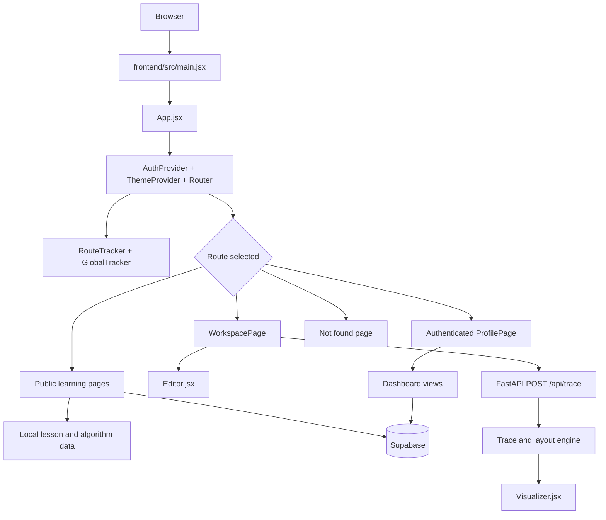
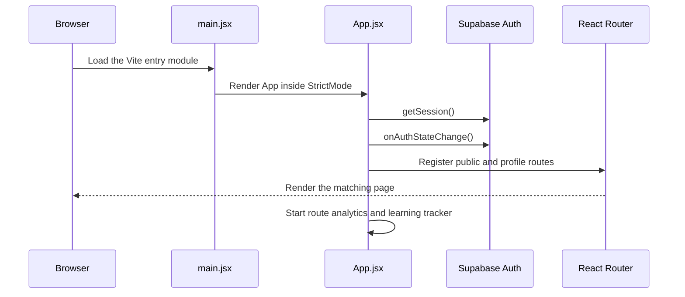
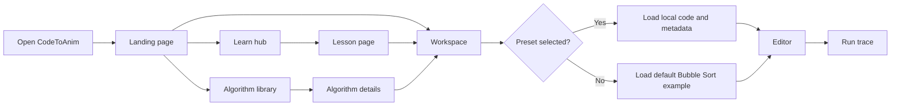
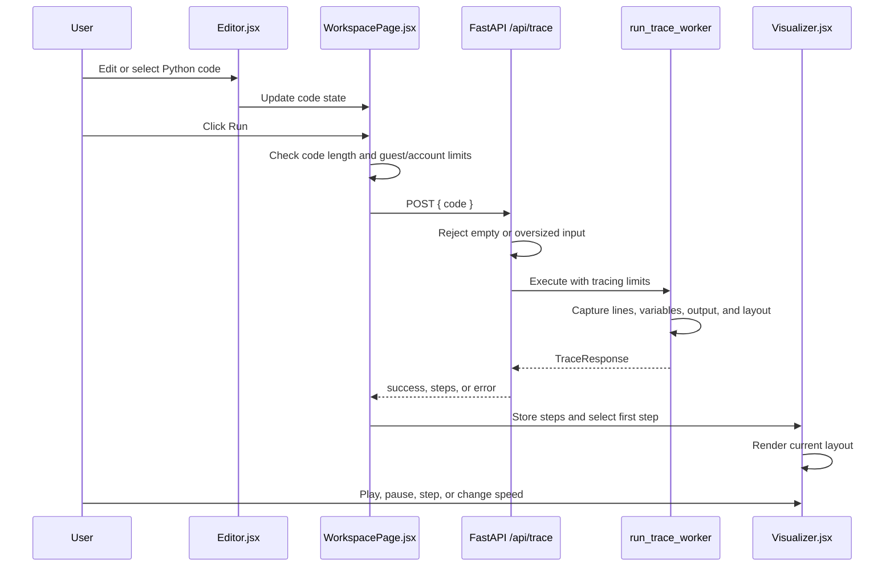
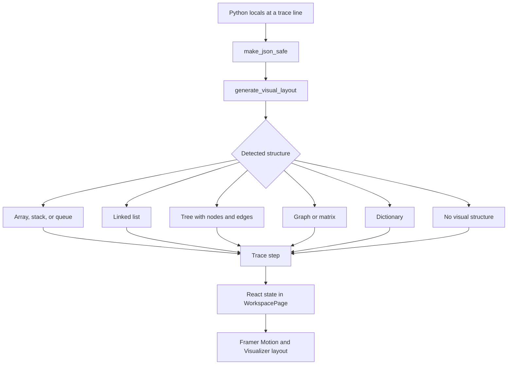
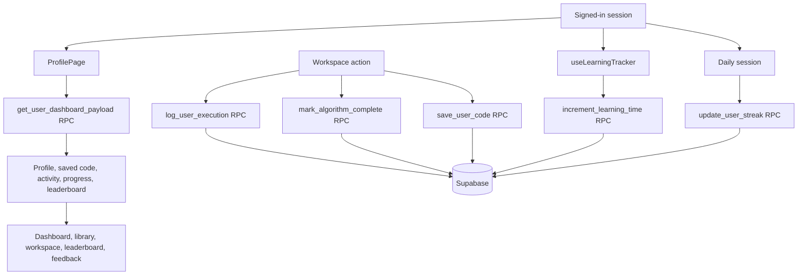

# How CodeToAnim Works

This guide explains the application from the first browser load to code execution, visualization, authentication, and progress tracking. It is written for contributors and for anyone adapting CodeToAnim into another product.

Created by **Gururaj Naik**.

> **Security limitation:** The trace backend executes user-submitted Python. It is an educational implementation, not a production sandbox. Anyone using it for a product must replace or harden the execution layer with Docker or equivalent isolation, strict resource limits, authentication, rate limiting, and monitoring. See [SECURITY.md](SECURITY.md).

## The Big Picture



The frontend owns the user experience and local catalogs. Supabase owns authentication and persisted user data. The FastAPI backend receives code and returns trace steps. The visualizer turns those steps into animated arrays, stacks, queues, linked lists, trees, graphs, and variable views.

## Startup Flow



### What happens at startup

1. Vite loads `frontend/src/main.jsx`.
2. React renders `App`.
3. `App` mounts `HelmetProvider`, `AuthProvider`, `ThemeProvider`, and `BrowserRouter`.
4. Supabase restores any existing session and listens for sign-in or sign-out changes.
5. The theme provider restores `light`, `dark`, or `coffee` from browser storage.
6. React Router renders the page for the current URL.
7. `RouteTracker` observes route changes. `useLearningTracker` measures active signed-in learning time.

## Visitor Learning Flow



Public content is primarily local and route-driven:

- Lessons come from `frontend/src/data/lessonsData.js`.
- Algorithms come from `frontend/src/data/algorithmsData.js`.
- LeetCode practice content comes from `frontend/src/data/leetcodeData.js`.
- A lesson or algorithm can open the workspace with code and metadata in router state or query parameters.

Guests can view public content and run within the frontend's guest limits. Direct code editing, saving, progress, and other account features require authentication.

## Authentication Flow

```mermaid
flowchart TD
    Open[User opens login modal] --> Choice{Choose action}
    Choice --> Login[Email and password login]
    Choice --> Signup[Create account]
    Choice --> OAuth[GitHub or Google OAuth]
    Choice --> Forgot[Password recovery]

    Login --> SupabaseAuth[Supabase Auth]
    Signup --> SupabaseAuth
    OAuth --> SupabaseAuth
    Forgot --> SupabaseAuth

    SupabaseAuth --> Result{Session available?}
    Result -->|Yes| Context[AuthContext stores user]
    Result -->|Email verification needed| Verify[User verifies email]
    Verify --> Context
    Context --> Profile[/profile]
    Result -->|Error| Message[Human-readable auth error]
```

`AuthContext` is the frontend source of truth for the current user. `App` also keeps a session guard for `/profile`. A signed-in session enables dashboard data, code saving, completion tracking, and learning-time tracking.

## Workspace Execution Flow



### Trace response shape

Each successful trace returns an ordered `steps` array. A step contains:

- `step`: sequence number
- `line`: source line being traced
- `variables`: JSON-safe visible variables
- `output`: captured standard output
- `visual_layout`: detected structure for the visualizer

The backend currently limits execution time, trace steps, output size, and code length. These limits reduce accidental abuse but do not provide container-level security.

## How Visualization Works



`backend/main.py` detects common data structures from the traced variables. `frontend/src/components/Visualizer.jsx` chooses the matching renderer and uses Framer Motion for transitions. The current step is controlled by `WorkspacePage` through `currentStepIndex`.

## Signed-In Progress Flow



Supabase RPCs and table policies are part of the deployment contract. The frontend calls them, but authorization must be enforced by Supabase Row Level Security and server-side function checks, not by hidden UI controls.

## Route Responsibilities

| Route | Owner | Purpose |
| --- | --- | --- |
| `/` | `LandingPage` | Entry point and animated product demo |
| `/learn` | `LearnHub` | Browse lessons |
| `/learn/:category/:topic` | `LessonPage` | Read a lesson and open practice |
| `/algorithms` | `AlgorithmLibrary` | Search and filter algorithms |
| `/leetcode` | `LeetcodeProblems` | Browse practice problems |
| `/workspace` | `WorkspacePage` | Edit, execute, and visualize code |
| `/profile` | `ProfilePage` | Authenticated dashboard shell |
| `/p/:userId` | `PublicProfileCard` | Read-only public profile |
| `/leaderboard` | `Leaderboard` | Public learning rankings |
| `/reset-password` | `ResetPassword` | Complete password recovery |

## Important Modules

| Module | Responsibility |
| --- | --- |
| `frontend/src/main.jsx` | Browser entry point |
| `frontend/src/App.jsx` | Providers, auth bootstrap, routes, trackers |
| `frontend/src/context/AuthContext.jsx` | Supabase session and auth modal state |
| `frontend/src/context/ThemeContext.jsx` | Theme selection and browser persistence |
| `frontend/src/pages/WorkspacePage.jsx` | Workspace state, limits, API calls, playback |
| `frontend/src/components/Editor.jsx` | Code editing and keyboard history |
| `frontend/src/components/Visualizer.jsx` | Animated structure and variable rendering |
| `frontend/src/data/` | Local educational catalogs |
| `frontend/src/hooks/useLearningTracker.js` | Active learning-time synchronization |
| `backend/main.py` | Trace API, execution limits, and layout detection |

## Configuration and Deployment Boundaries

- Frontend configuration uses `VITE_SUPABASE_URL`, `VITE_SUPABASE_ANON_KEY`, and `VITE_API_BASE_URL`.
- Backend CORS uses `CODETOANIM_ALLOWED_ORIGINS`.
- `frontend/vercel.json` rewrites client routes to `index.html`.
- `backend/vercel.json` routes API requests to FastAPI on Vercel.
- `.env` files are local configuration and must never be committed.

The frontend can be deployed separately from the backend. For a real public product, place the trace service behind an isolated execution system and keep production database credentials away from the code runner.

## A Contributor's Fast Path

1. Start at `frontend/src/main.jsx` and `frontend/src/App.jsx`.
2. Follow the route into the page that owns the behavior.
3. Follow shared state through `AuthContext`, `ThemeContext`, or the owning hook.
4. For execution, follow `WorkspacePage` to `backend/main.py` and back to `Visualizer`.
5. Keep static educational content in `frontend/src/data/`.
6. Run the frontend lint/build checks and backend syntax check before opening a pull request.

For project setup, see [README.md](README.md). For contribution rules, see [CONTRIBUTING.md](CONTRIBUTING.md). For known security limitations, see [SECURITY.md](SECURITY.md).
